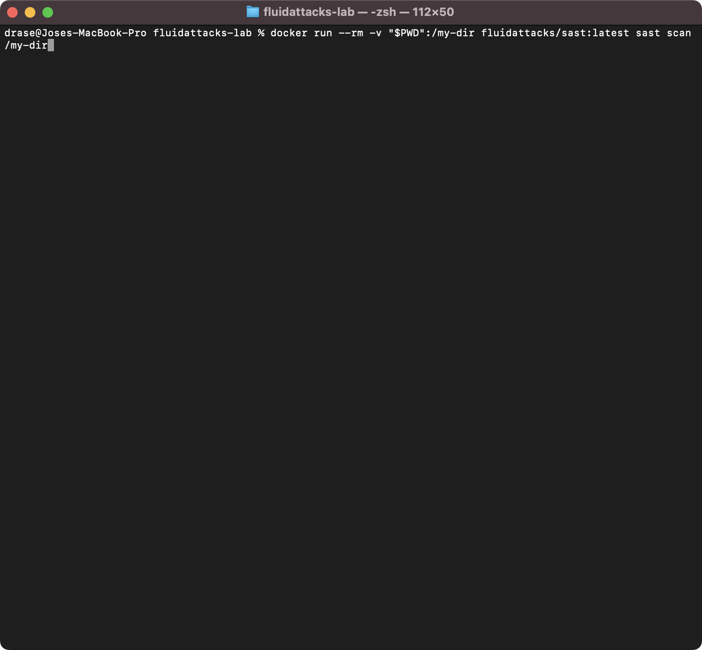
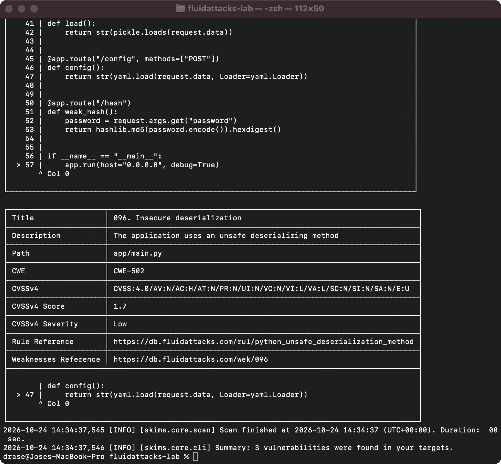

# fluidattacks-lab

App Flask deliberadamente vulnerable para probar los escáneres SAST, SCA y Secret Scan de Fluid Attacks. No desplegar: todas las credenciales en `app/` son falsas y apuntan a hosts `*.example` que no existen.

## Paso 1: CLI local

```bash
cd ~/fluidattacks-lab
docker pull fluidattacks/sast:latest
docker run --rm -v "$PWD":/my-dir fluidattacks/sast:latest sast scan /my-dir
```





## Pasos 2 a 4: GitHub Actions

Cada escáner lee su propio archivo de configuración en `.fluidattacks/`.

| Paso | Configuración | Resultado | Commit |
|------|---------------|-----------|--------|
| 2 | `strict: false`, sin archivo de salida | Verde, solo informa | [f777081](https://github.com/Josem0117/fluidattacks-lab/commit/f7770816e810ec2d26b7c1d91fe02a23d131daba) |
| 3 | `strict: true`, CSV | Rojo: falla con cualquier hallazgo | [e9b810b](https://github.com/Josem0117/fluidattacks-lab/commit/e9b810b75dd60f719b78a508d4132723a55dfa08) |
| 4 | `strictness_threshold: high`, CSV | Solo falla SCA (dos CVE High, 8.1) | [ce2813c](https://github.com/Josem0117/fluidattacks-lab/commit/ce2813ca5e3c01419c563c1c2c8dd587fc0dca8a) |

Los CSV quedan como artefactos descargables de cada ejecución.

Las acciones convierten el código de salida 1 del escáner en la salida `vulnerabilities_found` y terminan en verde, así que en los pasos 3 y 4 un paso "Break the build" hace fallar el job cuando esa salida es `true`.

`ss-action` está fijada a un commit de `main` porque la versión 0.3.0 usa una imagen de `ss` que ignora `strictness_threshold`.
